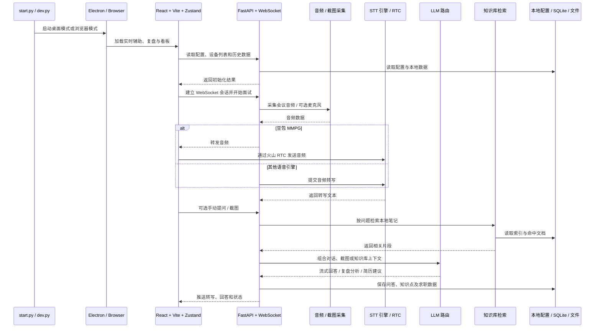

# 智能面试学习辅助助手

实时听题，自动生成专业面试回答。你可以把它理解成一个开着就能用的面试辅助工具：你负责听题和临场反应，它负责转写、答题、截图审题，卡壳的时候还能把问答框挂在旁边。

面向技术面试准备与复盘：支持会议音频和麦克风双路转写、截图审题、多模型切换、知识库引用；Electron 端提供共享隐身、Boss Key、托盘和悬浮窗。屏幕共享保护的效果取决于操作系统及会议软件，请在使用前自行验证。

<p align="center">
  
  
  
  
  
  
</p>

https://github.com/user-attachments/assets/1013b772-c59d-4ec4-8256-f932caa8ea3c

<p align="center">
  
  <br />
  <sub>上面是 GitHub 附件视频直链，可在仓库页直接播放；下方保留 GIF 作为静态预览，仓库内原始视频文件仍保留在 <code>docs/screenshots/assist-demo.webm</code>。</sub>
</p>

## 为什么值得试

> 不是“问答玩具”，而是围绕技术面试现场的节奏设计：听题、识别问题、生成答案、必要时引用你自己的笔记，并把共享隐身和悬浮窗能力一起纳入桌面端主流程。

| 场景 | 能力 |
| --- | --- |
| **实时面试** | 会议音频识别面试官发言；可选麦克风转写自己的回答，为追问和复盘提供上下文 |
| **语音与模型接入** | Whisper、FunASR、Qwen3-ASR、豆包、豆包 MMPG、通用 ASR 六种引擎；支持 Chat、Messages、Responses 三种 LLM 接口 |
| **手动与截图答题** | 手动输入或粘贴图片；截图审题、多图提交和笔试模式 |
| **个人材料接入** | 简历上传、简历优化、本地知识库检索与回答引用 |
| **桌面端使用体验** | 共享隐身、Boss Key、托盘、悬浮窗，以及位置、字体、颜色和透明度设置 |
| **复盘与提升** | 面试复盘、手动触发知识点能力分析、求职看板和 Offer 对比 |

## 面试主流程

1. 在「设置 → 模型」配置可用模型，在「设置 → 语音」选择识别引擎。
2. 选择会议音频设备并开始；如需记录自己的口述，在语音设置中启用「我的回答记录」，再选择独立的麦克风设备。
3. 面试官发言触发自动答题；启用麦克风后，已转写的双方发言可按顺序用于实时语音上下文，候选人的口述本身不会触发自动答题。
4. 也可手动输入问题、粘贴图片或截图审题；在「设置 → 模式」可开启适用于手动输入和截图的笔试模式。
5. 开启知识库后，回答可引用本地笔记。需要复盘时，可在「能力分析」中选择分析模型并手动分析待处理问答；已记录的候选人口述也可用于分析。
6. 使用桌面模式时，可按需调整悬浮窗位置、尺寸、文字与透明度；`⌘⇧J / Ctrl+Shift+J` 可折叠实时转录面板。

## 主界面速览

<p align="center">
  
</p>

## 关键能力雷达

<table>
  <tr>
    <td width="50%" valign="top">
      <h3>实时辅助</h3>
      <p>会议音频与可选麦克风双路转写、结合对话上下文流式回答、手动提问、截图审题、知识库引用与多协议模型接入。</p>
    </td>
    <td width="50%" valign="top">
      <h3>桌面协同</h3>
      <p>Electron 端提供共享隐身、Boss Key、托盘和快捷键；悬浮窗支持按模式调整位置、尺寸、字体、颜色与透明度。</p>
    </td>
  </tr>
  <tr>
    <td width="50%" valign="top">
      <h3>训练与复盘</h3>
      <p>面试及笔试复盘、候选人口述记录、手动触发的能力分析与薄弱点沉淀。</p>
    </td>
    <td width="50%" valign="top">
      <h3>求职材料</h3>
      <p>简历上传与摘要、JD 对照优化、求职看板、Offer 对比，把面试前后动作收在一个工具里。</p>
    </td>
  </tr>
</table>

## 模块画廊

<table>
  <tr>
    <td width="50%"></td>
    <td width="50%"></td>
  </tr>
  <tr>
    <td align="center"><strong>能力分析</strong><br /><sub>知识点趋势、问答沉淀、薄弱项复盘</sub></td>
    <td align="center"><strong>简历优化</strong><br /><sub>把简历和 JD 放到一起，输出更像“能投出去”的版本</sub></td>
  </tr>
</table>

## 功能总览

| 模块 | 现在能做什么 |
| --- | --- |
| **实时辅助** | 会议音频与可选麦克风转写、结合双方发言生成回答、手动提问和截图审题 |
| **笔试模式** | 手动输入或截图答题，可配置截图范围、多图提交和支持的模型推理选项 |
| **知识库** | 上传 `.md` / `.txt` / `.log` / `.docx` / `.pdf`，支持检索测试、最近命中和回答引用 |
| **面试复盘** | 记录真实问答、ASR 纠错、逐题分析和整场总结 |
| **能力分析** | 手动分析待处理问答，生成知识点标签与趋势；可单独设置分析模型和提示词 |
| **简历优化** | 上传简历，对照 JD 给出优化建议和改写方向 |
| **求职看板** | 表格 / Kanban、状态标签、拖拽排序、Offer 对比 |
| **设置中心** | 模型与语音引擎、按场景编辑系统提示词、悬浮窗样式、主题和快捷键 |

## 技术结构



### 技术栈

| 层 | 技术 |
| --- | --- |
| **前端** | React 18 · TypeScript · Vite · Zustand · Tailwind CSS · Playwright |
| **后端** | Python 3.10+ · FastAPI · Uvicorn · WebSocket |
| **语音识别** | faster-whisper · FunASR · Qwen3-ASR · 豆包流式 ASR / MMPG · 通用 ASR |
| **LLM** | OpenAI 兼容接口 · 多模型并行 · Think 推理 · 识图 |
| **存储** | SQLite · 本地简历历史 · 知识库索引 |
| **桌面** | Electron |

## 快速开始

### 1. 准备环境

- Python `3.10+`；全新 Windows 开发环境建议使用 Python 3.12。
- Node.js `18+` 和 npm。
- 音频采集设备；系统音频配置见[音频配置](docs/音频配置.md)。

### 2. 获取项目并安装依赖

```bash
git clone https://github.com/wusurqing/interview-helper.git
cd interview-helper

python -m pip install -r backend/requirements.txt

cd frontend
npm install
npm run build
cd ..
```

首次启动时，如默认配置文件不存在，应用会从 `backend/config.example.json` 创建本地 `backend/config.json`；也可以在启动后通过设置中心配置。已有配置不会因首次初始化被覆盖。

### 3. 配置模型与语音

在「设置 → 模型」添加模型并选择接口类型：

- **Chat**：OpenAI 兼容 `/chat/completions`。
- **Messages**：Anthropic `/v1/messages`。
- **Responses**：OpenAI `/responses`。

Base URL 带不带 `/v1` 都可适配；模型队列支持并行竞速、健康检查与故障降级。按需在「设置 → 系统提示词」分别编辑语音回答、手动提问、截图、笔试、复盘和简历优化等场景的指令。

在「设置 → 语音」选择转写引擎：

| 引擎 | 运行位置与配置 |
| --- | --- |
| **Whisper** | 本地 `faster-whisper`，支持多语种；首次使用需准备模型文件。 |
| **FunASR** | 本地识别，支持中文和岗位热词；执行 `python -m pip install funasr torch`，然后在语音设置中下载模型。 |
| **Qwen3-ASR** | 本地 GPU 识别，需要 CUDA 和单独安装的可选依赖；安装及 GPU 检查见 [Qwen3-ASR 本地部署](docs/qwen-local.md)。 |
| **豆包** | 火山引擎云端流式 ASR，需要开通服务并配置凭据。 |
| **豆包 MMPG** | 火山 RTC 会话式 ASR，支持智能判停与续说；需 Windows 本机后端，以及桌面应用或通过 localhost 打开的本机浏览器。在语音设置中配置 RTC、火山引擎和豆包 ASR 凭据，并可先运行「保存并测试 MMPG」。 |
| **通用 ASR** | 云端 OpenAI 兼容音频转写接口，需要配置服务地址与凭据。 |

豆包 MMPG 会将所选设备的音频发送到火山引擎，使用云服务可能产生费用。会议音频和候选人麦克风两路同时使用 MMPG 时，须配置 RTC App Key 并选择自动签发 Token。若主链路使用本地引擎，候选人链路的本地引擎跟随主链路。

其他参考：

- [配置说明](docs/配置说明.md)与 [API 密钥与模型](docs/API密钥与模型.md)。
- [豆包流式 ASR 配置参考](docs/豆包语音识别.md)：仅适用于原有豆包流式 ASR，不是 MMPG 指南；其中部分界面描述已过时，请以当前设置页面为准。

### 4. 启动应用

```bash
python start.py                 # Electron 桌面模式
python start.py --mode network  # 浏览器 / 局域网模式，本机访问 http://localhost:18080
```

Windows 也可双击 `启动.bat`，或运行 `python quick_start.py`；首次运行会尝试安装缺少的依赖。首次启动时，如前端尚未构建，启动器会尝试安装前端依赖并构建；桌面模式还会检查 Electron 依赖。

### 本地日志与隐私

大模型请求默认记录在项目根目录的 `log/llm.jsonl`，其中包含完整提示词和回复；图片输入可能保存到 `log/llm_assets/`。已知 API Key 等凭据会脱敏，但日志和图片仍可能包含简历、问答或截图等敏感内容。`log/` 已被 Git 忽略，请妥善保管，详见[大模型调用日志](backend/README.md#大模型调用日志)。

## 开发与自测

在项目根目录运行一条命令，即可打开 Electron 桌面端进行本地调试。

```bash
python dev.py
```

前端通过 Vite 热更新，修改 Python 源码后启动器会自动重启后端。终端会显示实时日志，按 `Ctrl+C` 停止。修改 Electron 主进程或 preload 后，重新运行命令即可生效。

首次运行会安装缺少的依赖，并优先使用当前 Python 虚拟环境或项目下的 `.venv`。全新检出时请用 Python 3.12 创建环境，例如安装 Python 3.12 后在 Windows 执行 `py -3.12 dev.py`。之后可直接使用 `python dev.py`。模型与语音沿用 `backend/config.json` 中的本地配置（也支持 `IA_CONFIG_PATH`）。

```bash
python dev.py --web                                    # 使用默认浏览器调试
python dev.py --backend-port 18081 --frontend-port 5174 # 默认端口被占用时换一组端口
```

前端默认使用 `127.0.0.1:5173`，后端默认使用 `127.0.0.1:18080`，两者都只监听本机。

```bash
cd frontend && npm test
cd ../backend && python -m pytest tests -q
```

## README 素材更新

```bash
cd frontend
npx playwright install chromium   # 首次执行需要
npm run screenshots:readme
npm run demo:readme
```

生成结果会输出到 `docs/screenshots/`：

- `assist-demo.webm`：主流程原始视频素材
- `assist-demo-poster.png`：视频封面
- `assist-demo.gif`：README 顶部实际使用的 GIF 演示
- `assist-mode.png`：实时辅助界面
- `knowledge-map.png`：能力分析
- `resume-optimizer.png`：简历优化

更多说明见 [docs/screenshots/README.md](docs/screenshots/README.md)。

## 项目结构

```text
interview-helper/
├── start.py
├── quick_start.py / quick-start.py
├── dev.py
├── backend/
│   ├── main.py
│   ├── api/
│   ├── core/
│   ├── services/
│   └── tests/
├── frontend/
│   ├── src/
│   ├── scripts/
│   └── package.json
├── desktop/
└── docs/
```

## 常见问题

- **Node / npm 报错**：请确认 Node.js 版本为 `18+`。
- **Electron 下载慢**：可先设置 `ELECTRON_MIRROR=https://npmmirror.com/mirrors/electron/`，再进入 `desktop/` 执行 `npm install`。
- **macOS 下 sounddevice 安装失败**：先执行 `brew install portaudio`。
- **Whisper 模型下载慢**：可设置 `export HF_ENDPOINT=https://hf-mirror.com`。
- **中文/术语识别不准（如 RAG 被听错）**：主链路切到 FunASR 并下载模型，配合设置 → 热词里的岗位自定义词；Whisper 用户也可在热词页配置提示偏置。
- **转写时风扇狂转**：设置 → 节奏 → 性能，调低「本地 ASR 推理线程数」（默认自动 = min(8, 核数-2)）。
- **端口冲突**：可改用 `python start.py --port 9090`。

## 开源协议与免责

- **协议**：[CC BY-NC 4.0](https://creativecommons.org/licenses/by-nc/4.0/)
- **免责**：项目仅供学习研究，请勿用于学术不端、违规考试或其他不合规场景；使用后果自行承担。
